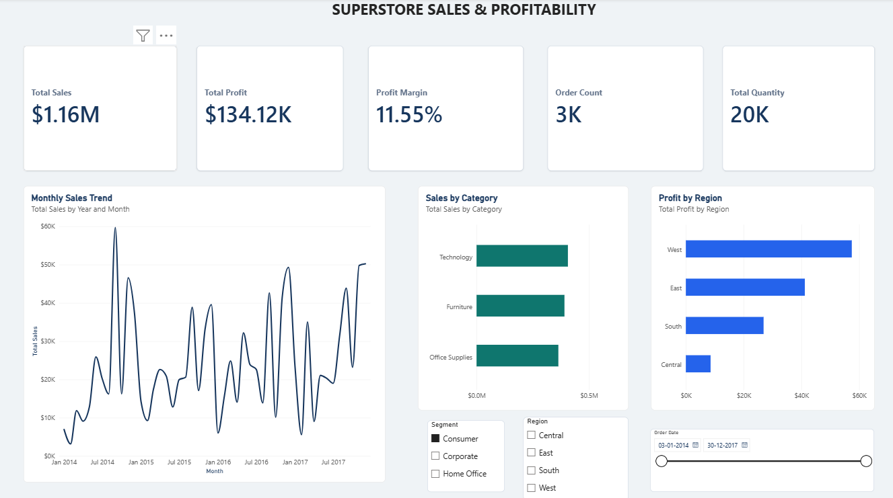
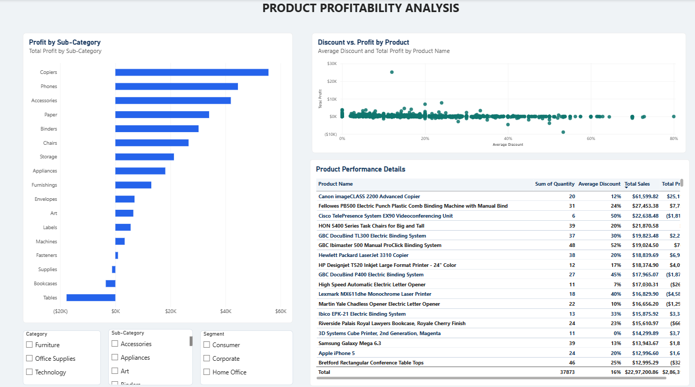

# Superstore Sales & Profitability Analysis

An interactive Power BI dashboard exploring retail sales performance, profitability, product trends, and regional results using the Sample Superstore dataset.

## Project Overview

This project analyzes retail transaction data to understand what drives sales performance, which product categories contribute to profitability, and where the business experiences losses.

The dashboard is designed to help users explore business performance through interactive visuals and filters.

## Tools & Technologies

- **Power BI** — dashboard design and data visualization
- **Power Query** — data preparation and data type management
- **DAX** — measures and business calculations

## Dashboard Pages

### 1. Executive Overview

Provides a high-level view of business performance, including:

- Total Sales
- Total Profit
- Total Quantity
- Order Count
- Customer Count
- Monthly sales trends
- Sales by category
- Profit by region

**Interactive filters:** Order Date, Region, and Segment.

### 2. Product Profitability

Examines product and sub-category performance to help identify profitable products and areas of concern.

- Profit by sub-category
- Product-level sales and profit comparison
- Average discount versus total profit
- Product table with sales, profit, quantity, and average discount

**Interactive filters:** Category, Sub-Category, and Segment.

## Key Findings

- The Tables sub-category is a notable loss-making area in the analyzed data.
- Bookcases and Supplies also show negative profit in the dashboard.
- Product profitability varies, so sales volume alone is not enough to evaluate performance.
- The discount-versus-profit comparison shows both profitable and loss-making products at different discount levels. Discount alone should not be treated as proof of the cause of losses.

## Screenshots

### Executive Overview

### Product Profitability

## Dataset

The project uses the Sample Superstore dataset.

[View the dataset source on GitHub Gist](https://gist.github.com/SharmaAshwini/8bd642f6c46792a9c40c8ccad60391e9)

## Files Included

- `Superstore_Sales_Analysis.pbix` — Power BI project file
- `executive-overview.png` — Executive Overview screenshot
- `product-profitability.png` — Product Profitability screenshot
- `README.md` — Project documentation

## Skills Demonstrated

Data preparation, data modeling fundamentals, DAX measures, KPI reporting, interactive dashboard development, exploratory business analysis, and communicating data-driven findings.

---

*Created as a portfolio project to demonstrate practical Power BI and business data analysis skills.*
